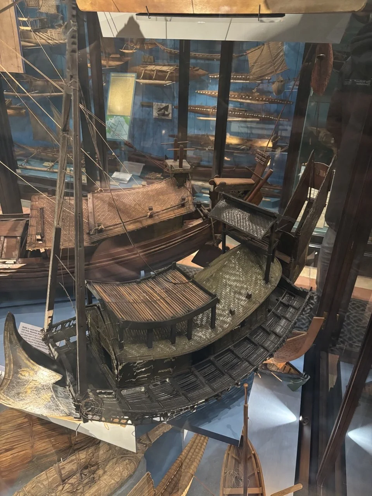
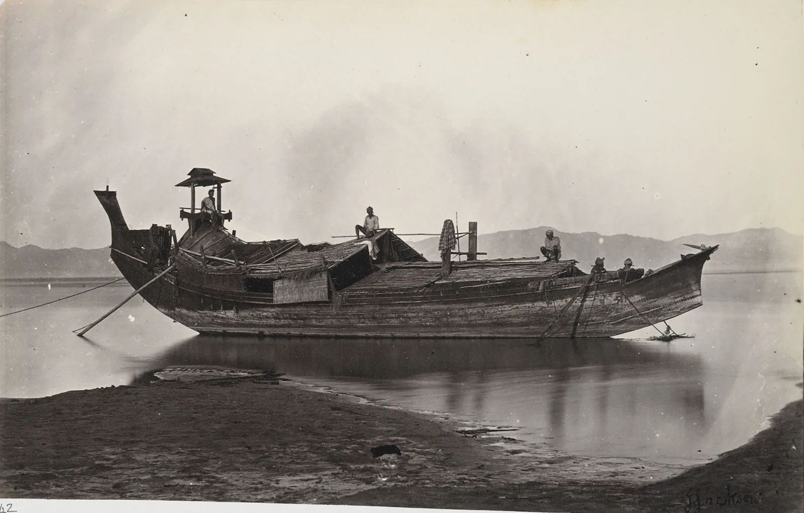
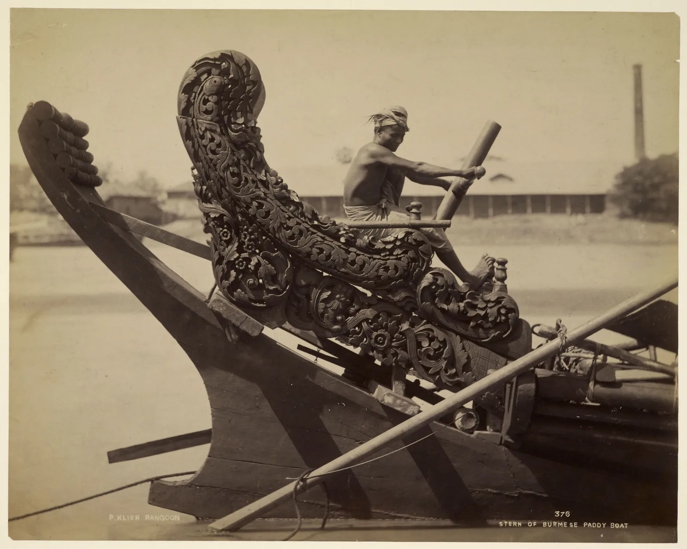
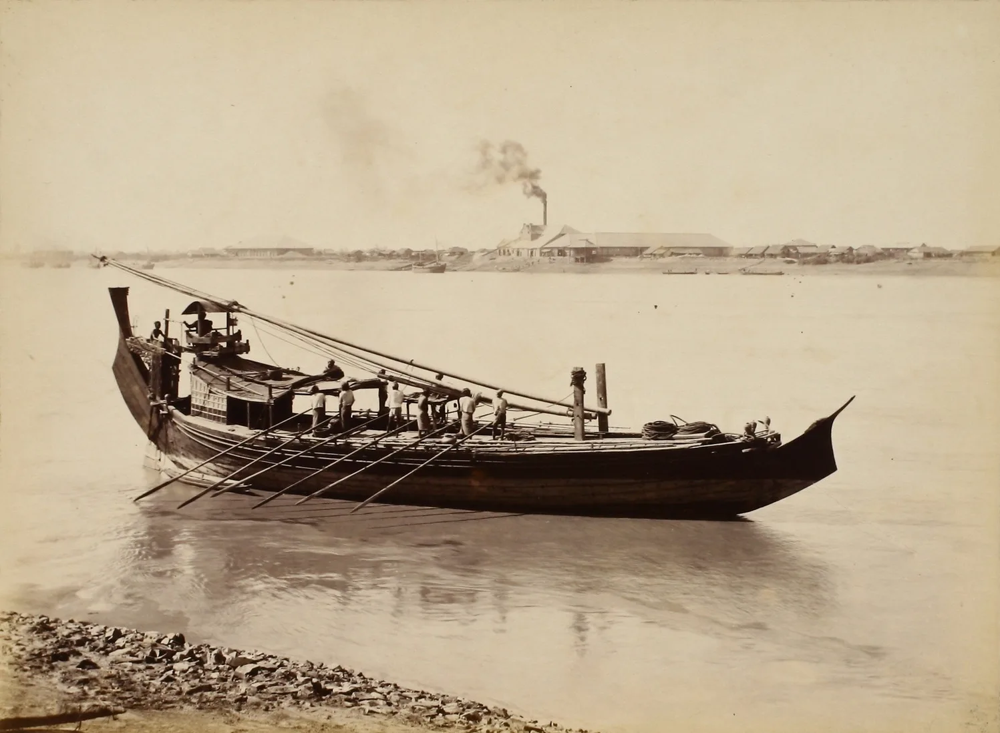

<article class="da rba" markdown="1" data-stations="off" data-brand="Irrawaddy rice boat" data-brand-sub="hull, rudder, rig, river · a long read" data-contact="https://www.linkedin.com/in/niklas-abraham-05983b247">

Blog · Long read · history and engineering · a 3D model to take apart, a river map, three old photographs

<h1 class="da-title">The rice boat of the Irrawaddy, taken apart</h1>

In a case in Oxford stands the model of a long, dark boat with a gilded point at one end, mat roofs, a carved seat and a big flat blade at the other. It is a Burmese rice boat, the craft that carried paddy up and down the Irrawaddy for centuries until steamers and railways took the trade. Every part of it answers to the river: a hull grown from a single tree and opened by fire, a rudder hung on the side, a mast that can be laid down, sails that work only with the wind behind, and a gallery along both sides for men with poles. This article takes the boat apart, part by part, and follows it up the river and back.

Written by an AI, published by Niklas Abraham · 7 November 2026 · about 22 minutes · a 3D model, a map and three photographs

**This article was written by an AI.** I saw this boat in a museum case in Oxford and wanted to know what each part of it is for, so I asked Claude (an AI model from Anthropic) to research, write and code this article to help me learn more. The descriptions of the boat come from travellers and officials who saw these boats in use between 1855 and 1923 (Henry Yule, the *British Burma Gazetteer*, Max and Bertha Ferrars, R. T. Pritchett, R. Talbot Kelly, Herbert Thirkell White), read in scans of their books, and from the records of five museums that hold models; the trade numbers come from economic histories. Every claim carries a tag such as  that leads to the [reference list](#sources). The **3D model is my reconstruction**: the parts and their places follow the sources and the photographs, but all its dimensions are chosen, not measured, and where the sources disagree (on the sails, for one) the figure shows both readings. The prose may contain mistakes, so check what you rely on at its source. If you find an error, [message me on LinkedIn](https://www.linkedin.com/in/niklas-abraham-05983b247).

**The question.** Most boats in a museum case are mute: a hull, a roof, a mast, and a label of two lines. This one carries a label that begins "Model, in wood and ... river boat, Myanmar (Burma)", and goes on to say that until steam came such boats were widely used in Myanmar to carry rice on its largest river, the Irrawaddy . Why does a rice boat need a stern that rises higher than a man, a rudder that hangs off the side instead of behind, two masts that meet at the top, and a yard that bends? Each of these turns out to be an answer to one river: wide, shallow at low water and full of moving sandbanks, fast in the rains, and blessed for half the year with a wind that blows *up* it.

The article has four parts.

1. **The object.** What is in the case, and what the boat is called.
2. **The boat, part by part.** A 3D model to take apart, then the hull, the steering and the rig, each from the sources.
3. **The river.** How the boat went up with the monsoon and came down with the current, and what it carried.
4. **The end.** What steam and rail did to it, and what the model cannot tell.

<nav class="da-toc" markdown="0">
Contents
<ol start="0">
<li><a href="#case">What is in the case</a></li>
<li><a href="#boat">The boat, taken apart</a></li>
<li><a href="#hull">A hull grown from one tree</a></li>
<li><a href="#stern">Steering from on high</a></li>
<li><a href="#rig">A mast that folds and sails that only run</a></li>
<li><a href="#river">Up with the wind, down with the current</a></li>
<li><a href="#rice">What it carried</a></li>
<li><a href="#steam">Steam, rail and the end of the type</a></li>
<li><a href="#limits">What the model cannot tell you</a></li>
<li><a href="#sources">Sources</a></li>
</ol>
</nav>

Part I<strong>The object</strong>

<h2 id="case">00What is in the case</h2>

<figure class="rb-photo narrow">

<figcaption>The model in its case, photographed from above . At the left, the gilded point of the bow and the two legs of the shear mast; in the middle, the house with a roof of split bamboo and the arched mat roof behind it; along the side, the cross-beams of the poling gallery; at the right, the steersman's seat under a small woven canopy, the tiller and the tall stern. Behind it, models of outrigger canoes from the Pacific.</figcaption>
</figure>

The case is almost certainly in the Pitt Rivers Museum, whose boat models were moved in 2016 to a new case in the Court on the ground floor , and the museum holds eleven models of Burmese boats. The label in the photograph is not in any of their online records, so I cannot say for certain which one this is. The best candidate is 1889.29.40, given by R. C. Temple in 1889, which the record describes as fully rigged, with the mast near the bow and a steering oar by the stern on the port side, and which is on display . Another, 1884.81.17 from the founding collection, is a painted model with a basketry cabin, and its record says that rice boats "were often referred to as Laung-Zat" .

**The names do not line up.** The museums call the big rice boat the *laung-zat*   . Henry Yule, who went up the river with a British embassy in 1855, calls the commonest large Irrawaddy craft the *hnau*, of "120 or 130 tons" , and J. G. Scott, writing as Shway Yoe, speaks of "the hnaw, the big rice-boat" . For Max and Bertha Ferrars, who described Burmese boat-building in 1900, *laung* is any Burmese boat, *laung-gô* the boat built on a hollowed log, and *laung-zat* the large built-up boat of Upper Burma that imitates it . This article uses *laung-zat*, as the museums do, for the large rice boat with the high stern, and notes where a source means something narrower. The *pein-gaw*, the flat-bottomed oil boat of the same river, is a different type.

{: .da-bridge}
The model and the old photographs agree on the parts; what follows takes them one at a time.

Part II<strong>The boat, part by part</strong>

<h2 id="boat">01The boat, taken apart</h2>

The figure below is a reconstruction in three dimensions. It is not a scan of the model in the case: its hull is 24 metres long and 4.4 metres wide, sizes I chose to sit inside the range the sources give for the larger boats, and every part is placed where the photographs and descriptions of the next sections put it . The bow is on the left, as in the photograph above. Pick a part by its name or click it, take the boat apart, switch between going up the river under sail and coming down under the sweeps, and compare the two readings of the rig.

{% include rb.html kind="boat" id="rb-boat" wide=1 title="A laung-zat, taken apart" caption="Procedural 3D model of an Irrawaddy rice boat. The parts and their arrangement follow the sources of this article (Yule 1858, Gazetteer 1880, Ferrars 1900, Talbot Kelly 1908) and the photographs by Jackson (about 1868) and Klier (1880s and 1890s); all dimensions are chosen, not measured. 'Going up' sets the sails and stows the sweeps, 'coming down' furls the sails and puts the sweeps out. The two rigs are the two descriptions that disagree: one great sail with a small topsail (Yule, 1855) and six stacked square sails (Talbot Kelly, 1908). Drag to orbit, scroll to zoom." %}

{: .da-bridge}
The hull is the part that took longest to make, and it starts as a tree.

<h2 id="hull">02A hull grown from one tree</h2>

**The base is a dugout.** Every source agrees on this. Yule: "The keel-piece is a single tree hollowed out, and stretched by the aid of fire when green, a complete canoe in fact. From this, ribs and planking are carried up" . The *British Burma Gazetteer* of 1880 says of all the boats on the river, from the small canoe to the large earth-oil or rice boat, that they "have a dug-out for the foundation" .

**How a log becomes a hull.** The Ferrars give the whole process . The preferred wood is *thingàn* (*Hopea odorata*), "tough and durable, steams well, and grows near the water". A straight tree of four to twenty feet in girth and fifteen to seventy-five feet long is felled and hewn round. A narrow groove, about a tenth of the girth, is cut along its flattest side for seven-eighths of its length, leaving the ends solid, and through this slot the log is hollowed into a shell with a section "like the letter C", using a heavy chisel on a T-shaped handle, the *kyettaung*. Holes are bored at intervals as depth gauges, the shell is pared to an even thickness, the holes are plugged, and the hull is filled with water until the wood is soaked. Then it is emptied, a slow fire is lit under its whole length, and the edges of the slot are gripped by wooden forks lashed to long levers that use the bottom of the boat as fulcrum. As the wood softens the hull opens "until the originally vertical edges of the slot are horizontal". The beam is now double what it was, the displacement several times greater; the shell is opened a little too far, stout thwarts (*pagàn-byin*) are set into recesses, and it is allowed to close on them.

**Then the sides are built on.** To carry more, "long seamless planks, stiffened by mouldings and ribs" are built on above the solid hull, with an upper tier of thwarts in cargo boats, and the seam is luted from outside with bee-dammar (*pwenyet*); such boats carry ten to forty tons . In the larger boats "the planks are held together by numerous metal ties and look as if sewn together" . When boats were wanted bigger than any tree, eighty to a hundred tons, they were built of teak planks on frames, but in the shape of the dugout: "the lines of the laung-gô are rigidly adhered to ... a most remarkable example of conservatism of type". These two kinds, the opened log with built-on sides and its plank-built copy, "carry most of the rice to port" . This explains why the museum records disagree: one model is described as having a "dugout, flat bottomed hull" , another a "carvel (flush laid) planked hull" , and both kinds existed.

**Why this shape suits the river.** The rounded hull is "the most serviceable for the rivers of Burma, on account of the ease of getting it off shoals", but "it cannot sail near the wind, and it makes great leeway. Only a square-sail is carried" . Yule found the bow "low with beautiful hollow lines, strongly resembling those of our finest modern steamers", while "the stern rises high above the water, and below the run is drawn out fine to an edge" . Talbot Kelly saw the bows "sharply uptilted, the cut-water frequently rising clear of the water", and "half its length is covered by a deck-house for the crew" . Loaded, the freeboard was small, and to Pritchett "the high stern seems enough to turn the vessel over" . A *thingàn* hull lasted twenty to thirty years; in tidal water the bottom had to be cleaned and burnt against shipworm once a month .

**On deck.** The *Gazetteer* describes the layout that the photographs below show. "On the stern-half of the boat is a house in which the boatmen live and the forepart, which contains the goods carried, is covered by one or more strongly-made bamboo mats, strengthened by bamboo frame-work, which do not rise above the gunwale and which serve as a deck". In the larger boats a gallery of large bamboos runs along each side from stem to stern and "stretches out for two feet", and on it the boatmen pole: they "plant their bamboo poles firmly in the bank and resting the upper end in the hollow just above the collar bone lean forward at an acute angle and run together from stem to stern". The galley is "a shallow box filled with earth or ashes or both" .

<figure class="rb-photo">

<figcaption>A laung-zat on a sandbank, photographed by J. Jackson about 1868 (British Library, Sladen Collection, public domain ). Stern to the left, with the steersman on his raised seat under a small roof; the houses on the after half; the cargo deck forward, flush with the gunwale; the low pointed bow on the right. The mast is down: only the two posts it stands on are up, in the middle of the boat.</figcaption>
</figure>

{: .da-bridge}
The far end of the boat, where the steersman sits, is the part that a European visitor found strangest.

<h2 id="stern">03Steering from on high</h2>

**The stern** rises "ten or fifteen feet above the surface of the water" . In a canoe the sweep of that curve comes in one piece of wood; in a large boat "the still more ornamented poop has to be built up ... to get the full sweep of curve" . Klier's photograph shows what that meant: the stern post sweeps up and forward in one curve, and a wing of carved scrollwork arches from its head down over the steersman's seat. Herbert Thirkell White, remembering the river before the railways, saw the boats "with high stern where the helmsman sat aloft" .

<figure class="rb-photo">

<figcaption>"Stern of Burmese paddy boat", photographed by Philip Adolphe Klier in Rangoon in the late 1880s (British Library, public domain ). The steersman sits inside the carved stern with the head of the rudder in his hands.</figcaption>
</figure>

**The steersman's seat** was "a high bench or platform for the steersman, elaborately carved", which Yule calls "an indispensable appendage" . Pritchett saw "a state chair of elaborate carving", with the steersman's head "protected by a kind of Japanese parasol" . Height is the point: from up there he sees over the houses and the cargo to the water ahead, which on this river means the sandbanks. Talbot Kelly describes the steersman up on the roof of the deck house, where he can see the shoals .

**The rudder hangs on the side.** "The rudder is a large paddle lashed to the larboard quarter, and having a short tiller passing athwart the steersman's bench" . Larboard is the old word for port, the left side looking forward, and every source that names a side says port   . To Pritchett it seemed "such a very left-handed arrangement to have the rudder on the port hand some feet away from the side of the vessel, instead of being in a line with the keel. They consider that their system gives greater purchase" . My own reading adds two reasons on the river's side, which no source states: a blade lashed at the quarter can be lifted when the boat runs onto a sandbank, and it needs no sternpost and no hinges, which a hull grown from a log does not easily give. The price is effort: in his edition of the *Periplus*, Wilfred Schoff notes that "the quarter-rudder required a constant pull on the tiller by the hands of the steersman" .

**The oldest way to steer.** Schoff printed a sketch of exactly this stern beside a Greek merchant's guide to the Indian Ocean of the first century, with the caption "Stern of a Burmese rice-boat, showing method of steering, identical with the Egyptian and Roman rudders of the time of the Periplus" . On the Irrawaddy that ancient form was still in daily use when Klier took his photograph in the 1880s.

{: .da-bridge}
At the other end of the boat stands the engine: a mast that is not one spar but two, and a yard that bends.

<h2 id="rig">04A mast that folds and sails that only run</h2>

**The mast is a pair of shears.** "The mast consists of two spars; it is in fact a pair of shears, bolted and lashed to two posts rising out of the keel-piece, so that it can be let down, or unshipped altogether, with little difficulty. Above the mainyard the two pieces run into one, forming the topmast. Wooden rounds run as ratlines from one spar of the mast to the other, forming a ladder for going aloft" . Talbot Kelly saw it as "two bamboos lashed together at the top, their lower ends being made fast to the gunwale" . Why two legs? The sources do not say; my reading is that they spread the load over the width of a narrow hull with no deep keel to step a single pole in, and that a mast which can be laid down suits a river where the wind is useful for only half the year. In Jackson's photograph the mast is down and only its two posts stand in the middle of the boat. Smaller boats had a single mast that fell on the roof of the house when lowered .

**The yard bends upwards.** "The yard is a bamboo, or a line of spliced bamboos, of enormous length, and being perfectly flexible is suspended from the mast-head by numerous guys or halyards, so as to curve upwards in an inverted bow. A rope runs along this, from which the huge mainsail is suspended, running on rings like a curtain outwards both ways from the mast. There is a small topsail of similar arrangement". The sail was cheap cotton cloth. At Minhla Yule paced the half-yard of one boat: 65 feet, 130 feet for the whole spar, and he reckoned the mainsail at not much less than 4,000 square feet. Under sail, he wrote, "they look like a flight of colossal butterflies skimming the water" . 130 feet is about 40 metres, so the yard was far longer than the boat; that is the 'one great sail' rig of the figure above.

**Or six or seven sails.** Half a century later Talbot Kelly describes a different picture: "from bamboo yards curved slightly upwards, is spread a curious combination of six or seven square sails, which, though only of use when running before the wind, enable the boat to travel at a great speed" . The two descriptions may be of different boats, or of a rig that changed between 1855 and 1908; I did not find a source that reconciles them, and the figure shows both. Sail was shortened in an odd way: instead of reefing, "every alternate cloth, or as many as may be necessary, is taken out, giving a very droll appearance, so that there are vertical strips of alternate sail cloth and landscape" .

**Only before the wind.** All the sources say it: "These boats can scarcely sail, of course, except before the wind" ; "they only sail before the wind and carry an immense expanse of sail, to stem the current" . A square sail across the boat on a flexible yard, a round hull with no keel and great leeway: this machine cannot go to windward at all. It does not need to, because of the river it was built for.

{: .da-bridge}
A boat that only runs before the wind needs a wind that blows the right way at the right time. On the Irrawaddy, it does.

Part III<strong>The river</strong>

<h2 id="river">05Up with the wind, down with the current</h2>

The Irrawaddy runs about 2,170 km from the north of Myanmar to the Andaman Sea, and is navigable all year from Hinthada to Bhamo, 1,080 km ; in 1923 steamers could reach Bhamo "at all times", 689 miles from the sea . The monsoon rains fall from mid-May to mid-October, and between low water and flood the river rises by 9.7 to 11.4 metres at Mandalay and Prome . In the dry season it is "shallow, strewn with islands and with sandbanks which shift from year to year", so that "only flat-bottomed vessels of very shallow draught can pick their way", and steamers stuck on a bank could sit "high and dry for months till released by the rise of the river" .

**The wind blows up the river in the rains.** "In ascending the Irawadi ... during the rainy season, the wind is almost always favourable" . The current then runs at four to five knots, and the boats stem it with "an immense expanse of sail". "The course of the river and the prevailing wind are in their favour. During the rains these craft make two trips, north and south, and lie by in the dry weather" . Coming down, the boat "is propelled by oars, usually twelve to sixteen", and "during the monsoons, when strong winds blow upstream, sails are used instead of oars" . When neither served, there was the anchor: "the prevailing winds carry the craft with merchandise up the river, and on the return journey the stream brings them down, having the one resort to fall back upon, namely, to anchor till the weather moderates" . Against the current in a calm, the crew poled from the side galleries .



<figure class="rb-photo">

<figcaption>A paddy boat under sweeps at Rangoon, photographed by Klier in the 1890s (public domain ). The crew stand on the fore deck to row; the steersman sits under his roof on the high stern. On the far bank, a steam rice mill.</figcaption>
</figure>

**The crew** was five to twenty men on the large boats of Upper Burma, three to five on the small; boatmen earned twelve to sixteen annas a working day, and a cargo boat cost 1,000 to 3,000 rupees, most of it for the solid hull . The owner of the boat is the *hleshin* . On the Rangoon end of the trip Shway Yoe describes the big rice boat lying in a creek until "its owner shall have hit upon a lucky day", then "dropping leisurely down through the network of creeks into one of the main streams, and so making his way to Rangoon, or Bassein", and the crowd of paddy boats at the mills .

{: .da-bridge}
What filled the hold, and which way it went, depended on a border that the British moved in 1852.

<h2 id="rice">06What it carried</h2>

**Rice went up first.** Before 1852 the Burmese kings "absolutely prohibited the export of rice from their dominions" , and the rice of the delta went to the dry zone of Upper Burma and the royal capital, in "a small, irregular internal trade mainly from Lower to Upper Burma" . After the Second Anglo-Burmese War of 1852 the delta was British and the kingdom upriver depended on it: shipments from Lower to Upper Burma were 38,000 short tons in 1865, 112,000 in 1870 and 107,000 in 1885, and after the annexation of 1885 the flow went on as internal trade, 169,000 tons in 1888 . Up went rice, *ngapi* (fermented fish paste), dried fish, salt and imported goods; down came the manufactures of the north, cutch, lacquer, images and *parabaik* paper .

**Then the delta turned to the world.** Lower Burma became a rice frontier. Burma exported 318,000 short tons of rice in 1862/63 and an average of 2,411,000 tons a year between 1901/02 and 1910/11 . By the 1920s more than ten million acres were under rice, eight million of them in Lower Burma, and 2.6 million tons of cargo rice were expected for export from the 1921/22 crop ; before the Second World War Burma was the largest rice exporter in the world . The usual story credits the Suez Canal, opened in 1869, but Owen notes that Cheng and Ingram think its effect on rice "has often been exaggerated", and that Burmese rice often still went round the Cape under sail after 1869 . Most of that export rice came down the delta's creeks to the mills of Rangoon and Bassein, and the boats that carried it were the two kinds of hull in section 02, which "carry most of the rice to port" . The economic history of this frontier, its settlers, credit and land, is in Michael Adas's *The Burma Delta* .

{: .da-bridge}
The same decades that made Burma a rice exporter brought the machines that ended the rice boat.

Part IV<strong>The end</strong>

<h2 id="steam">07Steam, rail and the end of the type</h2>

**Steamers.** The Irrawaddy Flotilla Company was founded in 1865 with four government paddle steamers left from the war of 1852; by the late 1920s it ran more than 600 vessels and carried eight to nine million passengers and about 1.25 million tons of cargo a year, the largest fleet of river boats in the world  . Its cargo steamers each towed a flat or barge on either side . **Railways** followed: Rangoon to Prome, 161 miles, in 1877, and the whole line to Mandalay, 384 miles, early in 1889 . The Mandalay line ran up the Sittaung valley rather than the Irrawaddy, so the river trade survived it , but on a schedule set by steam.

Thirkell White, writing in 1923, saw what this did. "Most of these picturesque craft are softly and silently vanishing away. Multitudes of launches now make the sylvan creeks hideous with steam-whistles ... the graceful Burmese boats are being ousted from the carrying traffic by squat barges and squalid lighters" . The Ferrars had already written that the rice boats "have to endure a formidable competition from the river steamers" . The old type with the high stern was still seen until at least the Second World War; the boats now called laung-zat are double-ended and low at bow and stern . In 1942, as the Japanese army advanced, the Flotilla Company sank its own fleet .

{: .da-bridge}
What survives are photographs, a handful of travellers' pages, and models like the one in the case. A word on what a model of a model can and cannot show.

<h2 id="limits">08What the model cannot tell you</h2>

- **The dimensions are mine.** The 3D model's hull (24 m by 4.4 m), its mast and its sails are sized to look right against the sources, not measured. The sources give tonnages (10 to 150 tons, Yule's two boats 120 to 130 tons), log lengths (up to 75 feet) and one yard (130 feet), not a set of lines .
- **The rig is disputed.** One great sail with a small topsail (Yule, 1855) or six or seven stacked square sails (Talbot Kelly, 1908); the figure shows both and does not decide.
- **The rudder mounting is not described.** Yule says the paddle was "lashed" to the quarter; how exactly, and how high, no text I read says. The model hangs it in a lashing at the quarter, where the photographs show it.
- **The model in the case is not identified for certain.** Its label is not in the museum's online records; 1889.29.40 is the best match .
- **The house layout varied.** The *Gazetteer* puts the crew house on the after half and the cargo forward under flat mats, and the photographs agree; models with curved mat roofs further forward exist too .
- **Not read:** James Hornell's *Water Transport* (1946), which treats such boats, was not accessible, nor was the 1882 first edition of Shway Yoe.

{: .da-bridge}
The sources behind every statement follow, with how much of each I saw.

<h2 id="sources">09Sources</h2>

**Images and software.** The three historical photographs are in the public domain and are served from this site (Jackson and the first Klier photograph from the British Library via Wikimedia Commons; the second Klier photograph via Wikimedia Commons). The museum photograph is Niklas Abraham's. The 3D model is drawn with three.js (MIT licence, self-hosted in `assets/vendor/three/`); the model and the map are computed in the browser (`assets/js/boat-model.js`, `assets/js/boat-figs.js`). Nothing is loaded from outside this site.

The list is ordered by tag. "Opened" means the page, record or book scan itself was read; "snippet" that only a search result or catalogue record was seen; "photo" a photograph; "model" marks the choices of the 3D model.



</article>

